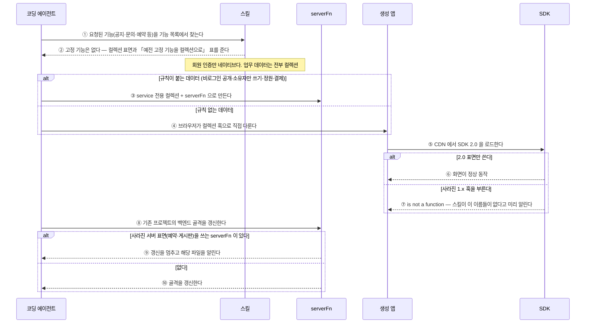

# 고정 기능을 뺀 SDK·스킬 2.0 (#131)

> 앵커의 줄번호는 **각 PR 머지 시점 스냅샷**이다. 최신 위치는 심볼 이름으로 찾는다.

## 의도

(이슈 #131 의 사용 시나리오 — 구현으로 인해 바뀌지 않는다. 후속 PR 도 이 절은 건드리지 않는다.)

> ⚠️ 이 시나리오는 구현을 마친 뒤 작성했다. 아래 표는 의도 대비 검증이 아니라 구현 지도다.

### 읽는 법

- **①~⑩** 은 아래 `단계 ↔ 코드` 표의 행과 1:1로 대응한다.
- `Note over X:` 는 그 지점의 **불변식**이다.
- `alt/else` 는 분기다. **양쪽 모두** 구현돼야 한다.
- 실선 `->>` 는 요청, 점선 `-->>` 는 응답이다.

## 단계 ↔ 코드

| 단계 | 코드 | 변경 | 설명 |
|---|---|---|---|
| ① 기능 목록 | `skills/baas-integration-sdk/features.json` · `"groups"` (L53-L312) | 수정 | 그룹은 account·collection·payment·storage 넷. collection 키워드에 게시판·공지·FAQ·문의·예약 신청 등을 넣어 그 요청이 컬렉션으로 매핑되게 했다 |
| ① 훅→그룹 매핑 | `skills/baas-integration-sdk/features.json` · `"hook_groups"` (L8-L45) | 수정 | 고정 기능 훅 매핑 삭제 — manifest 자동 동기화의 정본 |
| ② 고정 기능 없음 | `skills/baas-integration-sdk/SKILL.md` · `데이터 저장` (L106-L117) | 수정 | 사라진 훅 이름과 `is not a function` 경고, 임의 저장소 금지 |
| ② 예전 기능 → 컬렉션 | `skills/baas-integration-sdk/SKILL.md` · `예전 고정 기능을 컬렉션으로` (L158-L177) | 신규 | 기능별 컬렉션 설계와 「브라우저 직접 / serverFn」 구분 표 |
| ② 회원 인증만 네이티브 | `skills/baas-backend/SKILL.md` · `회원 인증만 네이티브다` (L320-L335) | 수정 | 「네이티브에 이미 있는 것을 다시 만들지 마라」와 그 예외 절을 대체 |
| ③ 소유자 화면 | `skills/baas-backend/SKILL.md` · `소유자 화면` (L756-L779) | 수정 | `sdk.reservation`·`sdk.board` 대신 `access:'owner'` serverFn + dyncol |
| ③ serverFn 선언 | `skills/baas-backend/boilerplate/src/serverFn.ts` · `serverFn()` (L73-L80) | 기존 | 규칙이 붙은 데이터의 진입점 |
| ③ 서버 SDK 표면 | `skills/baas-backend/boilerplate/src/platform/sdk.ts` · `buildSdk()` (L318-L790) | 수정 | `reservation`·`board` 와 그 타입 삭제. 반환은 dyncol·account·secrets·notify·payments·storage·ctx |
| ③ 서버 업로드 분류 | `skills/baas-backend/boilerplate/src/platform/sdk.ts` · `StorageCategory` (L299) | 수정 | `'images'` 하나 |
| ④ 컬렉션 훅 | `sdk/src/react/useCollection.ts` · `useCollection()` (L32-L145) | 기존 | 규칙 없는 데이터를 브라우저가 직접 다루는 표면 |
| ④ 레코드 조회 | `sdk/src/core/collection.ts` · `listRecords()` (L107-L109) | 기존 | 훅이 부르는 core 함수 |
| ④⑤ 공통 경로 | `sdk/src/core/http.ts` · `request()` (L43-L74) | 기존 | envelope 언랩·`X-Baas-Sdk-Version` 헤더 |
| ④ 실패 | `sdk/src/core/http.ts` · `BaasError` (L9-L18) | 기존 | 훅의 `error` 로 전달되는 오류 |
| ⑤ SDK 2.0 표면 | `sdk/src/react/index.ts` · `BaasSDK` (L12-L66) | 수정 | 고정 기능 함수·훅 삭제. core 엔트리의 export 와 모듈 7개(`board`·`notice`·`survey`·`reservation`·`store`·`inquiry`·`recipient`)·`useBoard.ts` 삭제 |
| ⑤ 결제 훅 | `sdk/src/react/moreHooks.ts` · `usePayment()` (L29-L40) | 수정 | 이 파일에 남은 유일한 훅 |
| ⑤ 구매약관 | `sdk/src/core/payment.ts` · `getPurchaseTerms` (L15-L16) | 수정 | 경로가 아직 store 네임스페이스라 TODO 표시 |
| ⑤ 업로드 분류 | `sdk/src/core/storage.ts` · `UploadCategory` (L24) | 수정 | `"images"` 하나 |
| ⑥⑦ 훅 계약 안내 | `skills/baas-integration-sdk/reference/sdk-surface.md` · `② 반환값 vs 훅 state` (L29-L49) | 수정 | 표에서 고정 기능 훅 행 삭제, v2.0.0 변경 안내 |
| ⑥ 결제 경로 | `skills/baas-integration-sdk/reference/sdk-surface.md` · `커스텀 화면에 결제를 붙일 때` (L393-L423) | 수정 | `beginWidgetCheckout` 삭제 — serverFn 세션 + `usePayment().beginWidget` 하나 |
| ⑧⑨ 사라진 표면 검사 | `skills/baas-backend/upgrade.mjs` · `removedSurfaceUsers()` (L58-L73) | 신규 | `src/services/*.ts`(스텁 제외)에서 `reservation.*`·`board.*` 호출을 찾는다 |
| ⑨ 갱신 멈춤 | `skills/baas-backend/upgrade.mjs` · `removedUsers` (L324-L330) | 신규 | 해당 파일을 알리고 종료 코드 4 |
| ⑨ 종료 코드 | `skills/baas-backend/upgrade.mjs` · `EXIT` (L50) | 수정 | `REMOVED_SURFACE: 4` 추가 |
| ⑩ 골격 갱신 | `skills/baas-backend/upgrade.mjs` · `applyUpgrade()` (L192-L226) | 기존 | 검사를 통과하면 기존 경로 그대로 |

## 미해결

- ⑦ 사라진 1.x 훅 호출은 실행 시점에 막지 않는다. 스킬 안내로만 막고, AI Studio 쪽 채널 선택(mbaas-inc/mBaas_AI_Studio#680)이 1.x 표면을 쓰는 앱을 1.x 채널에 남긴다.
- `getPurchaseTerms` 는 아직 `/public/store/{pid}/terms` 를 부른다. 서버가 store 밖으로 옮기면 함께 바꾼다.
- `stage` 병합은 `sdk-cd` 가 2.0 을 `next` 채널로 배포한다. 2.0 전용 채널(`v2`·`next-v2`)로 배포하도록 `sdk-cd` 를 맞추기 전에는 병합하지 않는다.

## 변경 이력

| 날짜 | PR | 내용 |
|---|---|---|
| 2026-10-14 | (이 PR) | 최초 작성 — ①~⑥·⑧~⑩ 구현, ⑦ 은 안내만 |
