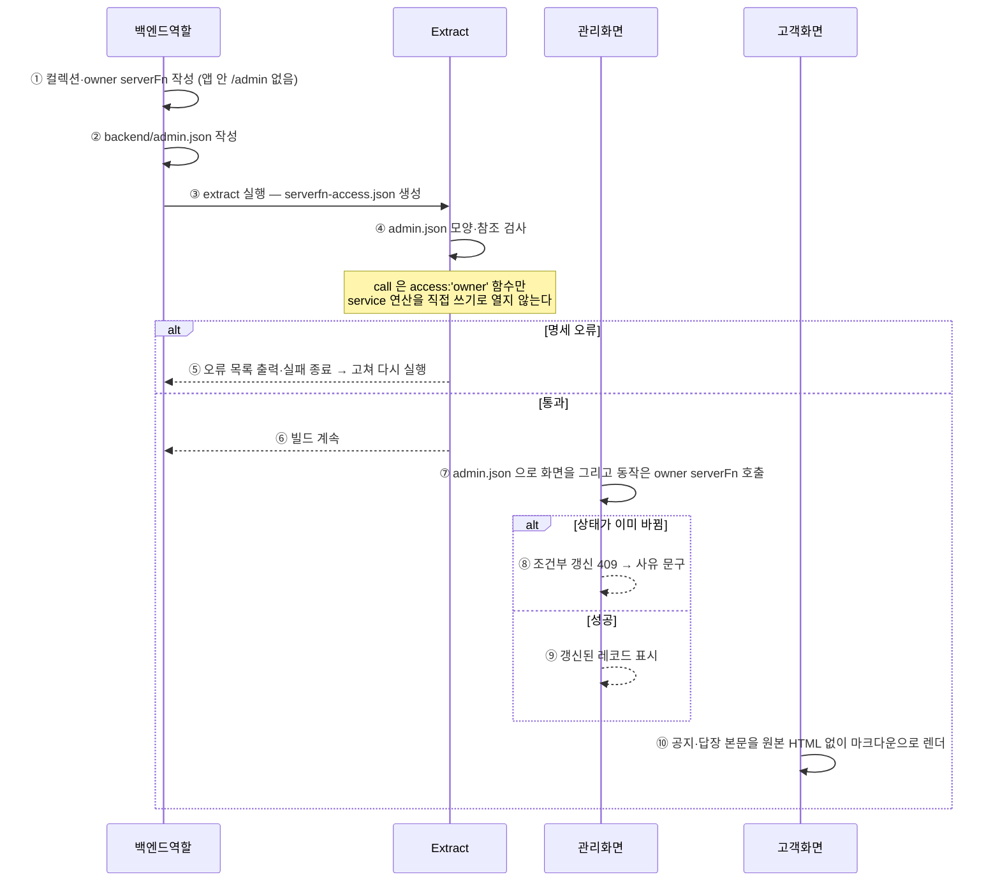

# 위젯형 관리 화면(admin.json)에 맞춘 스킬·골격 2.1 (#134)

> 앵커의 줄번호는 **각 PR 머지 시점 스냅샷**이다. 최신 위치는 심볼 이름으로 찾는다.

## 의도

(이슈 #134 의 사용 시나리오 — 구현으로 인해 바뀌지 않는다. 후속 PR 도 이 절은 건드리지 않는다.)

### 읽는 법

- **①~⑩** 은 아래 `단계 ↔ 코드` 표의 행과 1:1로 대응한다.
- `Note over X:` 는 그 지점에서 **반드시 성립해야 하는 불변식**이다.
- `alt/else` 는 분기다. **양쪽 모두** 구현돼 있어야 한다.
- 실선 `->>` 는 요청, 점선 `-->>` 는 응답이다.

## 단계 ↔ 코드

| 단계 | 코드 | 변경 | 설명 |
|---|---|---|---|
| ① 앱 안 관리 화면 제거 | `skills/baas-backend/SKILL.md` · `앱에는 관리 화면이 없다` (L652-L677) | 수정 | `/admin`·사장님 모드 배지·소유자 로그인 링크 지침을 걷어내고 AI Studio 관리 화면으로 넘긴다 |
| ① owner serverFn 계약 | `skills/baas-backend/SKILL.md` · `사장님 동작 serverFn — 입력 계약과 상태 전이` (L694-L714) | 신규 | 입력 `{id}`·`{ids}`·`{id?, data}`·대화 답장, 업무 실제 상태, 단건 `update(…, {if})` |
| ① 사장님 동작 예제 | `skills/baas-backend/examples/booking.server.ts` · `adminApprove` (L58-L63) | 신규 | `access:'owner'`, 이름 `booking.server.adminApprove` |
| ② 명세 작성 | `skills/baas-backend/SKILL.md` · `#### 명세` (L715-L767) | 신규 | 예시 admin.json·어휘 표·`input` 리스트 규칙·extract 검사 안내 |
| ③ 접근 매니페스트 | `skills/baas-backend/boilerplate/extract.mjs` · `accessManifest` (L647-L654) | **기존** | `<파일>.<export>` → `{access}` — 검사의 동작 대조 원본 |
| ④ 컬렉션 원본 | `skills/baas-backend/boilerplate/schema.mjs` · `readSchema()` (L102-L130) | **기존** | `schema.json` collections — 칸·access 대조 원본 |
| ④ 코드가 유도한 service 연산 | `skills/baas-backend/boilerplate/extract.mjs` · `serviceGrants` (L48) | **기존** | 규칙 컬렉션 판정에 함께 쓴다 |
| ④⑤⑥ 검사·실패·통과 | `skills/baas-backend/boilerplate/extract.mjs` · `checkAdminSpecFile()` (L579-L593) | 신규 | 명세가 있으면 검사, 오류면 목록 출력 후 `exit 1`, 통과면 한 줄 로그. serverFn 없음 경로(L596)와 매니페스트 기록 뒤(L655) 두 곳에서 부른다 |
| ④ 검사 진입 | `skills/baas-backend/boilerplate/admin-spec.mjs` · `checkAdminSpec()` (L390-L404) | 신규 | JSON 파싱 → 모양 → (모양이 맞을 때만) 참조, 30건 상한 |
| ④ 모양 검사 | `skills/baas-backend/boilerplate/admin-spec.mjs` · `shape()` (L55-L129) | 신규 | `admin.schema.json`(Studio pydantic 생성) — 모르는 속성·위젯 type·리스트 자리 객체·하이픈 동작 이름 |
| ④ 참조 검사 | `skills/baas-backend/boilerplate/admin-spec.mjs` · `references()` (L159-L360) | 신규 | 칸·컬렉션, owner 함수, service 직접 쓰기(`owner_content` 예외), richtext·markdown 은 글자 칸 |
| ⑥ 빌드 계속 | `skills/baas-backend/boilerplate/extract.mjs` · `await import('./build.mjs')` (L765) | **기존** | 검사를 지나야 번들로 간다 |
| ⑦ 관리 화면 렌더·호출 | — | — | 범위 밖 (AI Studio) |
| ⑧ 조건부 갱신 409 | `skills/baas-backend/examples/booking.server.ts` · `transition()` (L43-L56) | 신규 | 진 쪽은 다시 읽어 이미 그 상태면 그대로, 아니면 사장님이 읽을 409 문구 |
| ⑨ 성공·자리 반환 | `skills/baas-backend/examples/booking.server.ts` · `adminReject` (L65-L74) | 신규 | 이긴 쪽(`changed`)만 정원 `increment(-1)` |
| ⑩ 마크다운 렌더 | `skills/baas-integration-sdk/SKILL.md` · `마크다운 본문 렌더 — 공지·답장 본문` (L163-L174) | 신규 | 원본 HTML·`dangerouslySetInnerHTML` 금지, 링크 http·https·mailto, 사진 https |

## 미해결

- ⑦ 관리 화면 렌더·호출은 AI Studio(`/projects/{id}/manage`) 몫이다. 이 저장소는 명세를 쓰고 검사하는 쪽까지만 한다.
- `boilerplate/admin.schema.json` 은 AI Studio `manage/spec.py` 에서 생성한 사본이다. Studio 어휘가 바뀌면 다시 생성해야 한다(저장소 간 자동 동기화 검사는 아직 없다).
- 공지처럼 규칙 없이 사장님만 쓰는 콘텐츠를 `service` + `owner_content` 로 표현하는 것은 BaaS 접근값에 "사장님만 쓰기"가 없어서다 — aiapp-service#988 이 생기면 바꾼다.

## 변경 이력

| 날짜 | PR | 내용 |
|---|---|---|
| 2026-10-16 | (이 PR) | 최초 작성 — ①~⑥·⑧~⑩ 구현, ⑦ 은 AI Studio 범위 |
